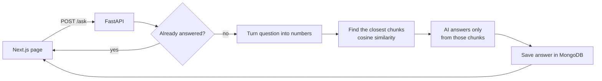

# Ask My Docs

I built an AI app that answers questions from my own documents, so it stops making stuff up.

## Why I built it
The first time I tested a local AI model, I asked it "Who is Chase Iwunze?" It told me I was a Nigerian goalkeeper. I played offensive line. That's called a hallucination: the AI didn't know the answer, so it guessed and sounded confident about it.

I wanted to fix that, so I added RAG (Retrieval-Augmented Generation). Now the app looks through my documents first, gives the AI only the parts that matter, and makes it answer from those. If the answer isn't in my documents, it says "I don't know" instead of guessing. It also shows which file the answer came from.

## Demo

https://github.com/user-attachments/assets/fa1079de-4166-4866-a7bb-dd078c597b96


## How it works


1. **Load my docs:** I split my documents into chunks, turn each chunk into an embedding (a list of 768 numbers that captures its meaning), and save them in MongoDB.
2. **Find the right chunks:** when a question comes in, I turn it into numbers the same way and use cosine similarity to find the chunks closest in meaning.
3. **Answer:** a local AI model (`qwen2.5:3b` through Ollama) answers using only those chunks.
4. **Cache:** every answer gets saved, so if someone asks the same thing again, it comes back instantly without running the AI.

## What I used
- **Frontend:** Next.js, React, TypeScript, Tailwind CSS
- **Backend:** FastAPI, Python
- **AI:** Ollama (`qwen2.5:3b` for answers, `nomic-embed-text` for embeddings)
- **Database:** MongoDB Atlas
- **Testing:** pytest and GitHub Actions. Every push runs my tests automatically. In the tests I fake the AI and the database, so they run anywhere.

## Decisions I made
- **I wrote the cosine similarity math myself** instead of using a library, because I wanted to actually understand how the search works.
- **I run the AI locally.** It's free and private. The downside is it's too heavy to host for free, so this one isn't deployed online.
- **I told the AI to say "I don't know"** instead of guessing. A wrong answer that sounds confident is worse than no answer.
- **I added caching** so repeat questions don't waste time running the model again.

## Run it yourself
```bash
# backend
cd backend
python3 -m venv ../.venv && source ../.venv/bin/activate
pip install -r requirements.txt
ollama pull qwen2.5:3b && ollama pull nomic-embed-text
# put MONGODB_URI=... in backend/.env
python ingest.py
uvicorn main:app --reload

# frontend (new terminal)
cd frontend && npm install && npm run dev
```

## What's next
I'm building a research agent that decides on its own whether to search the web or search these documents, then answers with sources.
